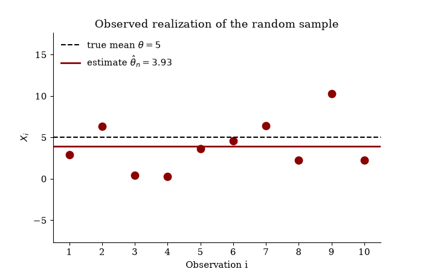
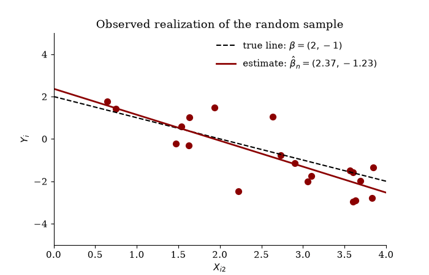

<!-- LTeX: language=en-US -->

# Monte Carlo Simulations



```{python}
#| echo: false
## Plot style and helpers (not part of the lecture code)
import os
import matplotlib
from matplotlib.animation import FuncAnimation, PillowWriter

matplotlib.rcParams.update({"font.family": "serif", "font.size": 11,
                            "axes.spines.top": False, "axes.spines.right": False})
anim_dir = "images/mc-python"
os.makedirs(anim_dir, exist_ok=True)

def md_table(df, align):
    """Return a pandas DataFrame as a Markdown table."""
    head = "| " + " | ".join(df.columns) + " |"
    sep  = "|" + "|".join(":--" if a == "l" else "--:" for a in align) + "|"
    body = ["| " + " | ".join(str(v) for v in row) + " |"
            for row in df.itertuples(index=False)]
    return "\n".join([head, sep, *body])
```

::: {.callout-note collapse="true"}
## Example: Estimating the Mean from an i.i.d. Random Sample

Let
$$
\{X_1, \ldots, X_n\}
$$
be an i.i.d. random sample with $X_i \sim F_X$ for all $i = 1, \dots, n$.

::: {.callout-tip icon=false}
## 🤫 Psst … Secret Information

In this simulation, $F_X = \mathcal{N}(\mu_X, \sigma^2_X)$ with $\mu_X = 5$ and $\sigma^2_X = 10$. In practice, $F_X$, and thus $\mu_X$ and $\sigma^2_X$, are **unknown**.
:::

We estimate the unknown mean $\theta \equiv \mu_X$ by the **sample mean**
$$
\hat\theta_n \equiv \hat\mu_n = \frac{1}{n}\sum_{i=1}^n X_i.
$$

The following code generates one realization of the random sample. The fixed seed, `default_rng(seed = 321)`, makes the pseudo-random numbers reproducible.

```{python}
#| echo: true
import numpy as np
import pandas as pd
import matplotlib.pyplot as plt
from scipy.stats import norm, chi2

rng = np.random.default_rng(seed = 321)

mean_X = 5
var_X  = 10
n      = 10

sample_X = rng.normal(loc = mean_X, scale = np.sqrt(var_X), size = n)
```

The observed realization, stored in `sample_X`, and the resulting estimate are

```{python}
#| echo: false
#| output: asis
vals = ",\\ ".join(f"{v:.2f}" for v in sample_X[:2]) + ",\\ \\dots,\\ " + f"{sample_X[-1]:.2f}"
print("$$\n\\{X_{1,\\operatorname{obs}}, \\ldots, X_{n,\\operatorname{obs}}\\} = \\{" + vals + "\\}\n$$")
print("$$\n\\hat{\\theta}_{n,\\operatorname{obs}} = \\frac{1}{n}\\sum_{i=1}^n X_{i,\\operatorname{obs}} = "
      + f"{sample_X.mean():.2f}" + ".\n$$")
```

A new sample yields a new estimate. The animation shows the observed sample (first frame, red) followed by further realizations of the random sample and of the estimator $\hat\theta_n$ (blue).

```{python}
#| echo: false
R        = 20                                   # number of realizations
X_sample = np.column_stack([sample_X,           # first column: observed sample
                            rng.normal(mean_X, np.sqrt(var_X), size = (n, R - 1))])

fig, ax = plt.subplots(figsize = (7, 4.5))
def draw_mean(r):
    ax.clear()
    col = "darkred" if r == 0 else "steelblue"
    est = X_sample[:, r].mean()
    ax.axhline(mean_X, ls = "--", lw = 1.5, color = "black",
               label = rf"true mean $\theta = {mean_X}$")
    ax.axhline(est, lw = 2, color = col, label = rf"estimate $\hat\theta_n = {est:.2f}$")
    ax.scatter(np.arange(1, n + 1), X_sample[:, r], s = 80, color = col)
    ax.set_xlim(0.5, n + 0.5)
    ax.set_ylim(mean_X - 4 * np.sqrt(var_X), mean_X + 4 * np.sqrt(var_X))
    ax.set_xticks(range(1, n + 1))
    ax.set_xlabel("Observation i")
    ax.set_ylabel(r"$X_i$")
    ax.set_title("Observed realization of the random sample" if r == 0
                 else f"Another realization ({r + 1} of {R})")
    ax.legend(loc = "upper left", frameon = False)

draw_mean(0)
fig.savefig(f"{anim_dir}/anim-mean.png", dpi = 100)
FuncAnimation(fig, draw_mean, frames = R).save(f"{anim_dir}/anim-mean.gif",
                                                writer = PillowWriter(fps = 1), dpi = 100)
plt.close(fig)
```

::: {.content-visible when-format="html"}

:::

::: {.content-visible unless-format="html"}

:::

**Summary:**

::: {.spaced-list}
* The data change from realization to realization, and so does the estimate. That is, $\hat\theta_n$ is a **random variable**, and $\hat{\theta}_{n,\operatorname{obs}}$ is just one of its realizations.

* The realizations of $\hat\theta_n$ lie close to the (usually unknown) true mean $\mu_X = 5$. That is, the distribution of $\hat\theta_n$ is **concentrated** around $\mu_X$. This concentration increases with the sample size $n$.
:::
:::


::: {.callout-note collapse="true"}
## Example: Estimating Regression Coefficients from an i.i.d. Random Sample

Let
$$
\{(Y_1, X_1^\top), \ldots, (Y_n, X_n^\top)\}
$$
be an i.i.d. random sample with $(Y_i, X_i^\top) \sim F_{YX}$ for all $i = 1, \dots, n$, where

::: {.spaced-list}
* $Y_i = X_i^\top \beta + \varepsilon_i$ is the outcome, and

* $X_i \in \mathbb{R}^K$ is the vector of predictors of observation $i$.
:::

::: {.callout-tip icon=false}
## 🤫 Psst … Secret Information

In this simulation, $X_i = (1, X_{i2})^\top$ with $X_{i2} \sim \mathcal{U}[0, 4]$, $\varepsilon_i \sim \mathcal{N}(0, 1)$ independent of $X_i$, and $\beta = (2, -1)^\top$. Together, these choices fully specify the joint distribution $F_{YX}$.

In practice, we assume (hopefully correctly) that we know the type of regression model, here the simple linear regression model
$$
Y_i = X_i^\top \beta + \varepsilon_i \quad\text{with}\quad X_i = (1, X_{i2})^\top.
$$

However, we know only the model's structure (here: an intercept and one predictor), not the entire model. In particular, we typically do **not know**:

::: {.spaced-list}
* the distribution of $X_i$,

* the distribution of $\varepsilon_i$, and

* the value of $\beta$.
:::

Thus, essential parts of $F_{YX}$, such as $\beta$, are **unknown**.
:::

We estimate the unknown coefficient vector $\theta \equiv \beta$ by the **OLS estimator**
$$
\hat\theta_n \equiv \hat\beta_n = \left(X^\top X\right)^{-1} X^\top Y,
$$
where
$$
X = \begin{pmatrix}
X_1^\top \\ X_2^\top \\ \vdots \\ X_n^\top
\end{pmatrix}
= \begin{pmatrix}
X_{11} & X_{12} & \cdots & X_{1K} \\
X_{21} & X_{22} & \cdots & X_{2K} \\
\vdots & \vdots & \ddots & \vdots \\
X_{n1} & X_{n2} & \cdots & X_{nK}
\end{pmatrix}
\quad\text{and}\quad
Y = \begin{pmatrix}
Y_1 \\ Y_2 \\ \vdots \\ Y_n
\end{pmatrix}
$$
are the $n \times K$ matrix of predictors and the $n \times 1$ vector of outcomes.

The following code generates one realization of the random sample and computes the estimate.

```{python}
#| echo: true
rng = np.random.default_rng(seed = 321)

n    = 20
beta = np.array([2, -1])

X   = np.column_stack([np.ones(n), rng.uniform(0, 4, size = n)])   # first column: intercept
eps = rng.normal(loc = 0, scale = 1, size = n)
Y   = X @ beta + eps

beta_hat = np.linalg.inv(X.T @ X) @ X.T @ Y
```

The observed realization, stored in `Y` and `X`, and the resulting estimate, stored in `beta_hat`, are

```{python}
#| echo: false
#| output: asis
obs = (f"({Y[0]:.2f},\\ 1,\\ {X[0, 1]:.2f}),\\ \\dots,\\ "
       f"({Y[-1]:.2f},\\ 1,\\ {X[-1, 1]:.2f})")
print("$$\n\\{(Y_{1,\\operatorname{obs}}, X_{1,\\operatorname{obs}}^\\top), \\ldots, "
      "(Y_{n,\\operatorname{obs}}, X_{n,\\operatorname{obs}}^\\top)\\} = \\{" + obs + "\\}\n$$")
print("$$\n\\hat{\\theta}_{n,\\operatorname{obs}} = "
      + f"({beta_hat[0]:.2f},\\ {beta_hat[1]:.2f})" + "^\\top.\n$$")
```

A new sample yields a new estimate. The animation shows the observed sample (first frame, red) followed by further realizations of the random sample and of the estimator $\hat\theta_n$ (blue).

```{python}
#| echo: false
R      = 20                                     # number of realizations
x_line = np.array([0, 4])
samples = [(X, Y)]                              # first sample: observed sample
for r in range(1, R):
    X_r = np.column_stack([np.ones(n), rng.uniform(0, 4, size = n)])
    samples.append((X_r, X_r @ beta + rng.normal(0, 1, size = n)))

fig, ax = plt.subplots(figsize = (7, 4.5))
def draw_ols(r):
    ax.clear()
    X_r, Y_r = samples[r]
    b_r = np.linalg.inv(X_r.T @ X_r) @ X_r.T @ Y_r
    col = "darkred" if r == 0 else "steelblue"
    ax.plot(x_line, beta[0] + beta[1] * x_line, ls = "--", lw = 1.5, color = "black",
            label = rf"true line: $\beta = ({beta[0]}, {beta[1]})$")
    ax.plot(x_line, b_r[0] + b_r[1] * x_line, lw = 2, color = col,
            label = rf"estimate: $\hat\beta_n = ({b_r[0]:.2f}, {b_r[1]:.2f})$")
    ax.scatter(X_r[:, 1], Y_r, s = 50, color = col)
    ax.set_xlim(0, 4)
    ax.set_ylim(-5, 5)
    ax.set_xlabel(r"$X_{i2}$")
    ax.set_ylabel(r"$Y_i$")
    ax.set_title("Observed realization of the random sample" if r == 0
                 else f"Another realization ({r + 1} of {R})")
    ax.legend(loc = "upper right", frameon = False)

draw_ols(0)
fig.savefig(f"{anim_dir}/anim-ols.png", dpi = 100)
FuncAnimation(fig, draw_ols, frames = R).save(f"{anim_dir}/anim-ols.gif",
                                               writer = PillowWriter(fps = 1), dpi = 100)
plt.close(fig)
```

::: {.content-visible when-format="html"}

:::

::: {.content-visible unless-format="html"}

:::

**Summary:**

::: {.spaced-list}
* The data change from realization to realization, and so does the estimate. That is, $\hat\theta_n$ is a **random vector**, and $\hat{\theta}_{n,\operatorname{obs}}$ is just one of its realizations.

* The estimated regression lines lie close to the (usually unknown) true line with $\beta = (2, -1)^\top$. That is, the distribution of $\hat\theta_n$ is **concentrated** around $\beta$. This concentration increases with the sample size $n$.
:::
:::







```{python}
#| echo: false
#| label: fig-mc-fx-py
#| fig-cap: "The two data distributions $F_X$. Both have mean $\\mu = 1$ (dashed line) and variance $\\sigma^2 = 2$."
x_norm = np.linspace(-4, 6, 500)
x_chi2 = np.linspace(0.01, 6, 500)
fig, ax = plt.subplots(figsize = (7, 3.5))
ax.plot(x_norm, norm.pdf(x_norm, loc = 1, scale = np.sqrt(2)), lw = 2, color = "steelblue",
        label = r"$\mathcal{N}(1, 2)$")
ax.plot(x_chi2, chi2.pdf(x_chi2, df = 1), lw = 2, color = "darkred", label = r"$\chi^2_1$")
ax.axvline(1, ls = "--", color = "black", lw = 1)
ax.set_ylim(0, 0.6)
ax.set_xlabel("x")
ax.set_ylabel("Density")
ax.legend(frameon = False)
plt.show()
```


### Step 3: Write the Simulation Code

We implement the algorithm from above in three parts.

**(a) Set the design parameters.**

```{python}
#| echo: true
rng = np.random.default_rng(seed = 123)

mu    = 1                              # true mean E(X)
sigma = np.sqrt(2)                     # true standard deviation sd(X)
n_seq = [5, 10, 20, 50, 100, 500]      # sample sizes
B     = 10000                          # Monte Carlo replications
alpha = 0.05                           # significance level
z     = norm.ppf(1 - alpha / 2)        # standard normal quantile

## Random number generators for the two distributions F_X
r_FX = {
    "Normal":     lambda n: rng.normal(loc = mu, scale = sigma, size = n),
    "Chi-square": lambda n: rng.chisquare(df = 1, size = n),
}
```

**(b) Write a function for one replication.** It performs Steps 1 and 2 of the algorithm: it simulates one data set and returns the estimate and whether the confidence interval contains $\mu$.

```{python}
#| echo: true
def one_replication(n, r_X):
    X_sim    = r_X(n)                               # 1. simulate data
    mu_hat   = X_sim.mean()                         # 2. compute estimate
    se_hat   = X_sim.std(ddof = 1) / np.sqrt(n)     #    and the CI (ddof = 1: divide by n - 1)
    CI_lower = mu_hat - z * se_hat
    CI_upper = mu_hat + z * se_hat
    covers   = (CI_lower <= mu) and (mu <= CI_upper)
    return mu_hat, covers
```

**(c) Repeat $B$ times for each design and compute the Monte Carlo approximations.**

```{python}
#| echo: true
rows      = []
estimates = {}                                      # keep realizations for plots

for dist, r_X in r_FX.items():
    for n in n_seq:
        sim = np.array([one_replication(n = n, r_X = r_X) for b in range(B)])
        mu_hat_B = sim[:, 0]                        # B realizations of the estimator
        covers_B = sim[:, 1]                        # B coverage indicators (0/1)

        estimates[(dist, n)] = mu_hat_B
        rows.append({
            "dist":     dist,
            "n":        n,
            "Bias":     mu_hat_B.mean() - mu,
            "Var":      np.mean((mu_hat_B - mu_hat_B.mean())**2),
            "Var_theo": sigma**2 / n,
            "MSE":      np.mean((mu_hat_B - mu)**2),
            "Coverage": covers_B.mean(),
        })

results = pd.DataFrame(rows)
```


### Step 4: Present the Results

@tbl-mc-results-py reports the Monte Carlo approximations for all designs. @fig-mc-hist-py shows the simulated distributions of $\bar X_n$, and @fig-mc-mse-cov-py shows the MSE and the coverage probability as functions of $n$.

```{python}
#| echo: false
#| output: asis
#| label: tbl-mc-results-py
#| tbl-cap: "Monte Carlo approximations ($B = 10{,}000$) for the sample mean. `Var (theory)` is the exact variance $\\sigma^2/n$. The nominal coverage is 0.95."
tab = results.copy()
for col in ["Bias", "Var", "Var_theo", "MSE"]:
    tab[col] = tab[col].map(lambda v: f"{v:.4f}")
tab["Coverage"] = tab["Coverage"].map(lambda v: f"{v:.3f}")
tab.columns = ["$F_X$", "$n$", "Bias", "Var", "Var (theory)", "MSE", "Coverage"]
print(md_table(tab, align = "lrrrrrr"))
```

```{python}
#| echo: false
#| label: fig-mc-hist-py
#| fig-cap: "Histograms of the $B = 10{,}000$ realizations of $\\bar X_n$. The black curve is the normal approximation $\\mathcal{N}(\\mu, \\sigma^2/n)$ implied by the CLT; the dashed line marks $\\mu = 1$."
cols   = {"Normal": "steelblue", "Chi-square": "darkred"}
labels = {"Normal": r"$\mathcal{N}(1, 2)$", "Chi-square": r"$\chi^2_1$"}
fig, axes = plt.subplots(2, 2, figsize = (7, 5.5))
for i, dist in enumerate(r_FX):
    for j, n in enumerate([5, 50]):
        ax    = axes[i, j]
        est   = estimates[(dist, n)]
        lo, hi = mu - 4 * sigma / np.sqrt(n), mu + 4 * sigma / np.sqrt(n)
        ax.hist(est[(est > lo) & (est < hi)], bins = np.linspace(lo, hi, 41),
                density = True, color = cols[dist], edgecolor = "white")
        x_grid = np.linspace(lo, hi, 300)
        ax.plot(x_grid, norm.pdf(x_grid, loc = mu, scale = sigma / np.sqrt(n)),
                color = "black", lw = 2)
        ax.axvline(mu, ls = "--", color = "black", lw = 1)
        ax.set_xlim(lo, hi)
        ax.set_title(rf"$F_X$ = {labels[dist]}, $n = {n}$")
        ax.set_xlabel(r"$\bar X_n$")
        ax.set_ylabel("Density")
fig.tight_layout()
plt.show()
```

```{python}
#| echo: false
#| label: fig-mc-mse-cov-py
#| fig-cap: "Left: MSE versus $n$ on log-log scales; the black line is the theoretical MSE $\\sigma^2/n$. Right: coverage probability versus $n$; the gray band shows the range $0.95 \\pm 1.96 \\cdot \\sqrt{0.95 \\cdot 0.05 / B}$ expected from Monte Carlo error alone."
markers = {"Normal": "o", "Chi-square": "^"}
fig, (ax1, ax2) = plt.subplots(1, 2, figsize = (7, 3.8))

## MSE
n_grid = np.linspace(min(n_seq), max(n_seq), 200)
ax1.plot(n_grid, sigma**2 / n_grid, color = "black", lw = 1.5)
for dist in r_FX:
    sub = results[results["dist"] == dist]
    ax1.scatter(sub["n"], sub["MSE"], marker = markers[dist], color = cols[dist],
                s = 50, label = labels[dist], zorder = 3)
ax1.set_xscale("log")
ax1.set_yscale("log")
ax1.set_xlabel("n (log scale)")
ax1.set_ylabel("MSE (log scale)")
ax1.legend(frameon = False)

## Coverage
mc_se = np.sqrt(0.95 * 0.05 / B)
ax2.axhspan(0.95 - 1.96 * mc_se, 0.95 + 1.96 * mc_se, color = "0.85")
ax2.axhline(0.95, ls = "--", color = "black", lw = 1)
for dist in r_FX:
    sub = results[results["dist"] == dist]
    ax2.plot(sub["n"], sub["Coverage"], marker = markers[dist], color = cols[dist],
             lw = 1.5, label = labels[dist])
ax2.set_xscale("log")
ax2.set_ylim(0.7, 1)
ax2.set_xlabel("n (log scale)")
ax2.set_ylabel("Coverage probability")
ax2.legend(frameon = False, loc = "lower right")
fig.tight_layout()
plt.show()
```


### Step 5: Interpret the Results

```{python}
#| echo: false
def cov_of(d, n):
    return f"{results.loc[(results['dist'] == d) & (results['n'] == n), 'Coverage'].item():.3f}"
```

**Question 1: Bias, variance, and MSE.** The simulation confirms the theory (@tbl-mc-results-py and @fig-mc-mse-cov-py, left):

::: {.spaced-list}
* The bias is close to zero for all designs. The remaining deviations are of the order of the Monte Carlo standard error of the bias, $\sqrt{\operatorname{Var}(\bar X_n)/B}$, e.g., $\sqrt{0.4/10{,}000} \approx 0.006$ for $n = 5$.

* The variance and the MSE match $\sigma^2/n$ and decrease at rate $1/n$, i.e., with slope $-1$ on log-log scales.

* Both distributions yield the same results, since these properties depend on $F_X$ only through $\sigma^2$.
:::

**Question 2: Coverage.** Here the simulation reveals what asymptotic theory cannot (@tbl-mc-results-py and @fig-mc-mse-cov-py, right):

::: {.spaced-list}
* **Under-coverage for small $n$:** For $n = 5$, the coverage is only `{python} cov_of("Normal", 5)` (normal) and `{python} cov_of("Chi-square", 5)` ($\chi^2_1$) instead of $0.95$. Even for normal data, the interval is too short because it ignores the estimation uncertainty in $s_n$. (Using the $t_{n-1}$-quantile instead of $z_{1-\alpha/2}$ would fix this for normal data, but not for skewed data.)

* **The shape of $F_X$ matters:** Under the skewed $\chi^2_1$ distribution, the convergence to $0.95$ is much slower. Even for $n = 100$, the coverage is `{python} cov_of("Chi-square", 100)`. The reason is visible in @fig-mc-hist-py: for small $n$, the distribution of $\bar X_n$ is still skewed, so the normal approximation behind the interval is poor.

* **Large $n$:** For $n = 500$, the coverage is close to $0.95$ in both cases, as the CLT predicts.
:::

::: {.callout-tip icon=false}
## How Precise Are the Monte Carlo Results?

Monte Carlo approximations are themselves estimates based on $B$ replications. For a coverage probability $p$, the **Monte Carlo standard error** is
$$
\sqrt{\frac{p(1-p)}{B}} \approx \sqrt{\frac{0.95 \cdot 0.05}{10{,}000}} \approx 0.002.
$$
Thus, deviations from $0.95$ within about $\pm 0.004$ (the gray band in @fig-mc-mse-cov-py) can be pure Monte Carlo error, while the under-coverage found above is real. To halve the Monte Carlo error, quadruple $B$.
:::





## Simulation Example: Hypothesis Testing

We now apply the blueprint to a hypothesis test about $\mu$, using the same design as above: $F_X \in \{\mathcal{N}(1, 2), \chi^2_1\}$, $\sigma^2 = 2$, and $B = 10{,}000$.


<!-- Consistency section: commented out (redundant with the bias/variance simulations)

### Consistency

**Question.** By the definition of consistency above, the sample mean is consistent if
$$
P\left(\left|\bar X_n - \mu\right| \leq \varepsilon\right) \to 1 \quad\text{as}\quad n \to \infty
$$
for any $\varepsilon > 0$. How fast does this probability approach $1$, and how does the speed depend on $\varepsilon$?

**Code.** No new simulation is needed: we reuse the $B$ realizations of $\bar X_n$ stored in `estimates` and compute the Monte Carlo approximation
$$
\widehat{P}_{\operatorname{MC}}\left(\left|\bar X_n - \mu\right| \leq \varepsilon\right) = \frac{1}{B}\sum_{b=1}^B \mathbf{1}\left(\left|\hat\mu_{n,b} - \mu\right| \leq \varepsilon\right)
$$
for a grid of $\varepsilon$ values.

```{python}
#| eval: false
#| echo: true
eps_seq = np.arange(0, 1.505, 0.01)            # grid of epsilon values
n_plot  = [5, 20, 100, 500]                     # sample sizes to compare

def prob_close(mu_hat_B, eps):
    return np.mean(np.abs(mu_hat_B - mu) <= eps)

## One curve per distribution and sample size
prob_curves = {}
for dist in r_FX:
    for n in n_plot:
        mu_hat_B = estimates[(dist, n)]
        prob_curves[(dist, n)] = [prob_close(mu_hat_B, eps) for eps in eps_seq]
```

```{python}
#| eval: false
#| echo: false
#| label: fig-mc-consistency-py
#| fig-cap: "Monte Carlo approximations of $P(|\\bar X_n - \\mu| \\leq \\varepsilon)$ as functions of $\\varepsilon$. As $n$ grows, the curves approach $1$ for every $\\varepsilon > 0$."
n_cols = plt.cm.Blues(np.linspace(0.35, 1, len(n_plot)))
fig, axes = plt.subplots(1, 2, figsize = (7, 3.8))
for ax, dist in zip(axes, r_FX):
    for k, n in enumerate(n_plot):
        ax.plot(eps_seq, prob_curves[(dist, n)], lw = 2, color = n_cols[k], label = f"n = {n}")
    ax.axhline(1, ls = "--", color = "black", lw = 1)
    ax.set_ylim(0, 1.05)
    ax.set_xlabel(r"$\varepsilon$")
    ax.set_ylabel(r"$P(|\bar X_n - \mu| \leq \varepsilon)$")
    ax.set_title(labels[dist])
    ax.legend(frameon = False, loc = "lower right")
fig.tight_layout()
plt.show()
```

**Interpretation** (@fig-mc-consistency-py):

::: {.spaced-list}
* For every fixed $\varepsilon > 0$, the probability increases towards $1$ as $n$ grows. This is consistency.

* The smaller $\varepsilon$, the larger the sample size needed to get close to $1$. Consistency says only that the probability converges, not how fast.

* Both distributions behave very similarly. For the sample mean, consistency depends on $F_X$ essentially only through $\sigma^2$.
:::
-->


### Step 1: Define the Test and the Questions

Consider the test of
$$
H_0\colon \mu = \mu_0 \quad\text{against}\quad H_1\colon \mu \neq \mu_0
$$
based on the $t$-statistic
$$
T_n = \frac{\sqrt{n}\left(\bar X_n - \mu_0\right)}{s_n}.
$$
We reject $H_0$ if $|T_n| > z_{1-\alpha/2}$. By the CLT, as $n \to \infty$,

::: {.spaced-list}
* the **size**, i.e., the rejection probability if $H_0$ is true, converges to $\alpha$, and

* the **power**, i.e., the rejection probability if $H_0$ is false, converges to $1$.
:::

How large are size and power for small $n$?

::: {.callout-tip icon=false}
## Tests and Confidence Intervals

We reject $H_0\colon \mu = \mu_0$ if and only if $\mu_0 \notin \operatorname{CI}^{1-\alpha}_n$. Thus, under $H_0$,
$$
P\left(\text{reject } H_0\right) = 1 - P\left(\mu_0 \in \operatorname{CI}^{1-\alpha}_n\right),
$$
i.e., the size is one minus the coverage probability. The under-coverage found above therefore implies that the test rejects a true $H_0$ too often.
:::


### Step 2: Choose the Simulation Design

We test $\mu_0 = 1$ and vary the **true** mean $\mu$ over a grid from $0$ to $2$. To shift the mean without changing the shape of $F_X$, we generate
$$
X_i = \mu + U_i,
$$
where $U_i$ has mean zero and variance $2$: either $U_i \sim \mathcal{N}(0, 2)$ or $U_i \sim \chi^2_1 - 1$. We consider $n \in \{20, 100\}$.


### Step 3: Write the Simulation Code

As before, we write a function for one replication and repeat it $B$ times for each design.

```{python}
#| echo: true
mu_0    = 1                                       # hypothesized mean
mu_grid = np.round(np.arange(0, 2.05, 0.1), 1)  # true means
n_test  = [20, 100]                             # sample sizes

## Random number generators for the mean-zero errors U
r_U = {
    "Normal":     lambda n: rng.normal(loc = 0, scale = sigma, size = n),
    "Chi-square": lambda n: rng.chisquare(df = 1, size = n) - 1,
}

def one_test(n, mu_true, r_U_dist):
    X_sim  = mu_true + r_U_dist(n)                                 # 1. simulate data
    T_stat = np.sqrt(n) * (X_sim.mean() - mu_0) / X_sim.std(ddof = 1)  # 2. test statistic
    return abs(T_stat) > z                                            #    reject H0?

rows = []
for dist, r_U_dist in r_U.items():
    for n in n_test:
        for mu_true in mu_grid:
            reject_B = [one_test(n, mu_true, r_U_dist) for b in range(B)]
            rows.append({"dist": dist, "n": n, "mu": mu_true,
                         "Reject": np.mean(reject_B)})   # MC rejection probability

test_results = pd.DataFrame(rows)
```

### Steps 4 and 5: Present and Interpret the Results

@fig-mc-power-py shows the rejection probabilities as functions of the true mean $\mu$.

```{python}
#| echo: false
#| label: fig-mc-power-py
#| fig-cap: "Monte Carlo rejection probabilities of the $t$-test of $H_0\\colon \\mu = 1$ as functions of the true mean $\\mu$. At $\\mu = 1$ (dotted line), the curves show the size; elsewhere, they show the power. The dashed line marks $\\alpha = 0.05$."
fig, axes = plt.subplots(1, 2, figsize = (7, 3.8))
for ax, n in zip(axes, n_test):
    ax.axhline(alpha, ls = "--", color = "black", lw = 1)
    ax.axvline(mu_0, ls = ":", color = "black", lw = 1)
    for dist in r_U:
        sub = test_results[(test_results["dist"] == dist) & (test_results["n"] == n)]
        ax.plot(sub["mu"], sub["Reject"], marker = markers[dist], color = cols[dist],
                lw = 1.5, label = labels[dist])
    ax.set_ylim(0, 1.02)
    ax.set_xlabel(r"True mean $\mu$")
    ax.set_ylabel("Rejection probability")
    ax.set_title(f"n = {n}")
    ax.legend(frameon = False, loc = "lower left", fontsize = 9)
fig.tight_layout()
plt.show()
```

```{python}
#| echo: false
def rej_of(d, n, mu_val):
    sel = (test_results["dist"] == d) & (test_results["n"] == n) & np.isclose(test_results["mu"], mu_val)
    return f"{test_results.loc[sel, 'Reject'].item():.3f}"
```

::: {.spaced-list}
* **Size:** At $\mu = \mu_0$, the rejection probability for $n = 20$ is `{python} rej_of("Normal", 20, 1)` (normal) and `{python} rej_of("Chi-square", 20, 1)` ($\chi^2_1$) instead of $\alpha = 0.05$. As expected, this is approximately one minus the coverage probabilities in @tbl-mc-results-py; the small differences are Monte Carlo error.

* **Power:** The further $\mu$ is from $\mu_0$, the higher the power. For $n = 100$, the power is close to $1$ already for $|\mu - \mu_0| \geq 0.6$; for $n = 20$, a much larger distance is needed.

* **Skewness:** Under $\chi^2_1$, the power curve is **asymmetric**. For $n = 20$ and $\mu = 1.3$, the power (`{python} rej_of("Chi-square", 20, 1.3)`) is even smaller than the size. Again, the normal approximation is poor for skewed data and small $n$.
:::



